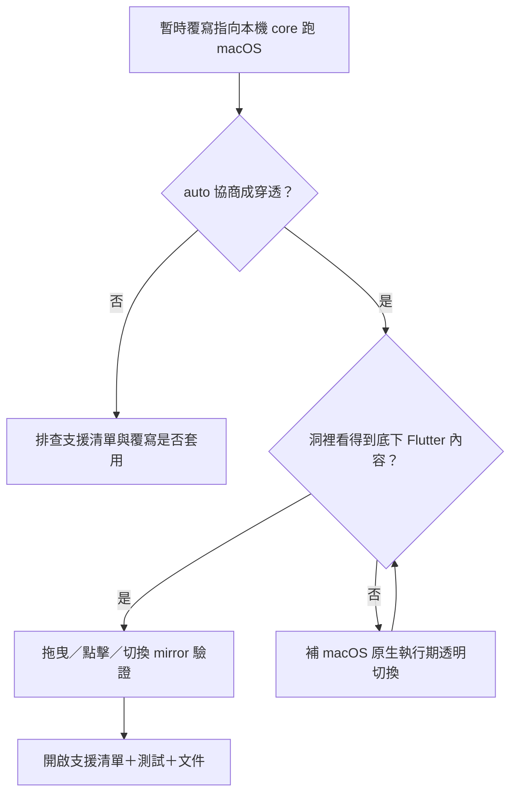

# Plan: 2611201345 - macos-passthrough
- Created: 2026-11-20
- Branch: feature/2611201345-macos-passthrough
- Issue: Aqutter/aqutter_core#41
- Milestone: N/A（未指定）
- Base Branch: main
- Status: Awaiting Archive
- Completed: [Wait for Finish]

## Goals
讓 `AqutterNative` 的穿透模式在 macOS 生效：`auto` 在 macOS 協商成穿透，而不是退回鏡像。

使用者要求「macOS 也做穿透」。macOS 目前沒有穿透實作（`aqutterNativePassthroughSupported` 不含 macOS），2026-11-20 實跑 macOS 版 aqutter-nuxt-app，mirror-demo 的 `aqutter-frame` 持續推幀（`fps: 2`），確認走鏡像。

## Architecture
穿透需要三件事（Android／iOS／Windows 已各自驗證）：支援清單開啟、WebView 能在執行期變透明、底層原生內容與網頁洞同位置。

| 項目 | macOS 現況（證據） | 本計畫動作 |
|---|---|---|
| 支援清單 | 不含 macOS（`lib/src/nativeview/native_mode.dart:91-94`） | 加入 macOS |
| WebView 透明 | 只在建立時處理：`transparentBackground` → `underPageBackgroundColor = .clear`（`macos/.../AqutterWebView.swift:139-141`）。執行期 `setSettings` 只處理 `underPageBackgroundColor`（`:770-775`），**沒有** `transparentBackground`；也沒有設 `drawsBackground`。殼是執行期切換（`aqutter/shell/lib/src/app.dart:795`） | 先驗證；不通過在 macOS 原生補執行期切換（iOS 對照：`ios/.../AqutterWebView.swift:1158-1166`） |
| 觸控路徑 | iOS 才需要 `NativeTouchRouter`（`lib/src/nativeview/native_touch_gate.dart:24`，僅 iOS）；Windows spike 通過時手勢照常轉給原生內容 | 預期不需要；驗證時確認拖曳與點擊，不通過再回報 |
| 驗證素材 | macOS 的 google-maps 走網頁端 JS 版地圖，沒有原生地圖（實跑畫面 `map unavailable`） | 用 mirror-demo（Flutter 自己畫的格線與圓球）驗證透明與位置 |

程式碼風格：遵守 `kn-project-code-style`（Dart；Swift 沿用該檔既有風格）。macOS 原生碼是 Swift，不涉及 Android，沒有 Kotlin 問題。

## Cross-Repo Scope
無（單一 repo）。`aqutter`（殼）、`aqutter-js`、`aqutter-plugins`、`aqutter-nuxt-app` 只作驗證環境：用 `pubspec_overrides.yaml` 暫時指向本機 core，不提交、驗證後還原；本計畫不改它們。

## Contract / 介面契約
無（單一 repo）。不改 core 與殼／網頁端之間的任何協定（WebSocket 訊息、`layout`、`mode` 沿用原樣），只改 core 內部的平台支援與 macOS 原生實作。

## Impact Files
- `lib/src/nativeview/native_mode.dart:91-94`（`aqutterNativePassthroughSupported`）— 加入 macOS。
- `lib/src/nativeview/native_mode.dart:34,85-86`（注解）— 「Android 與 iOS」「macOS、Linux 與 Web 沒有實作」與新行為矛盾（`:34` 還漏了 Windows）。
- `macos/aqutter_core/Sources/aqutter_core/AqutterWebView/AqutterWebView.swift:139-141,770-775` — 驗證不通過（整塊白的），補 `applyTransparentBackground`：關 `drawsBackground`（KVC，先確認 setter 存在）＋ `underPageBackgroundColor=.clear`；建立時與執行期 `setSettings` 都走它，還原時恢復原色。
- `test/nativeview_passthrough_test.dart:145-150` — 支援／不支援平台清單改為 macOS 支援、Linux／fuchsia 不支援。
- `test/nativeview_passthrough_test.dart:264-269` — 「不支援平台退回鏡像」的 widget 測試目前用 macOS 當不支援平台，改用 Linux。
- `doc/nativeview.md:108`、`:185`、`:189-198` 附近 — 支援平台列、「只有 iOS」句子的平台列舉、新增 macOS 驗證範圍與限制。
- `README.md:47` — 穿透平台「（Android、iOS）」改為四個平台（Windows 先前也漏了）。`README.md:3` 僅為套件涵蓋平台，不動。

## App-Flow Screens
（無 app-flow.json，略）

## Open Questions / 待確認事項
無。已確認項目見 `## Key Decisions`；「完成後」動作、分支與 issue 建立於核准閘一併請示。

## Manual Follow-ups / 人工收尾事項
- **[合併後]** 移動 `aqutter_core` 的 `0.0.0` tag 到新 main — `git tag -f 0.0.0 <新 main> && git push --force origin refs/tags/0.0.0`（記下舊值） — 強制更新 tag 是對外可見的覆寫，需人確認
- **[合併後]** `aqutter` 的 `manifest/releases.json`（core.ref）、`aqutter-cli` 的 `src/manifestSnapshot.json` 與 `aqutter-nuxt-app` 鎖定檔前進 — 比照 2611190044-sync-after-native-touch 的程序，各自另案 — 屬他 repo、本計畫範圍外
- **[合併後]** macOS release 建置、實機（非本機開發機）與 Intel Mac 未驗證 — 於實機跑 `aqutter dev macos` 對照 mirror-demo — agent 沒有其他機器

## Key Decisions
- **[Phase 0]** 單一 repo `aqutter_core`；Base Branch = `main`（無 `整合主幹` 記錄、遠端無 dev 類分支，不詢問）。core 另有 `2610211200-windows-platform-view-perf`（Awaiting Archive），與本計畫無關，不動。
- **[Milestone]** 不指定，base `main`（使用者選擇）；沒有 milestone 與 release，只有 tag `0.0.0`。
- **[不通過時]** 在 core 修 macOS 原生執行期透明切換再驗證（使用者選擇）；不通過不退回只改文件。
- **[驗證方式]** 真實整合（殼＋aqutter-js＋mirror-demo，macOS 本機 debug），暫時覆寫指向本機 core，不提交；沿用 Windows spike 作法。
- **[範圍]** 不實作 macOS 版 `NativeTouchRouter`：該路徑是 iOS 的 UIKit 觸控與 Flutter gesture arena 衝突所需；macOS 預期不需要，驗證時若出現拖曳抖動或手勢被吞，回報後再決定（改計畫須重新核准）。
- **[完成後]** commit + 開 PR（base main）— 使用者核准。
- **[驗證結果]** macOS 27.0.1 debug：`auto` 協商成穿透（`aqutter-mode` 事件 `passthrough`）；補原生前整塊白的（WebView 沒變透明）；補完後洞裡看得到底下格線與圓球、點擊／拖曳／雙擊正常、離開穿透頁後背景還原（map-effects 漸層背景正常）。使用者用肉眼確認——當時電腦控制被另一個 Claude 工作階段占用，無法截圖。
- **[執行中]** 不做 macOS 版 `NativeTouchRouter`：拖曳與點擊正常，沒有 iOS 的抖動——依計畫「範圍」決策。
- **[執行中]** README 一併改：先前只寫「Android、iOS」，Windows 也漏了，內容與新行為矛盾。

## Git Completion Policy
- PR 一律以 `--base main` 顯式指定 base，不依賴 `gh` 的預設值 (Rule 23)。
- Issue 綁定時，**每個 commit 訊息**與 PR body 都必須含 `Closes #${N}`（`${N}` 取自上方 `- Issue:`，**不是** `${ID}`）。歸檔完成後於該 issue 張貼由 archive 蒸餾的結案留言 (Rule 20)。
- Issue 的關閉發生在**合併後清理**（使用者回報已合併、內容驗證通過），不在歸檔當下 (Rule 21 步驟 6)；commit 關鍵字為保險絲，涵蓋未回報合併的情形。
- commit 一律自動（Rule 17）。完成時依核准閘的「完成後」選項：選 push 或 PR 才會 `git fetch` 後 `git rebase origin/main` 並更新遠端工作分支（`git push --force-with-lease --force-if-includes`）；選只 commit 則兩者都不做。
- PR/archive order: Archive automatically triggered on PR request
- 單一 repo，本 repo 自己開自己的 PR。

## References
- 前例：`.kn-project/archive/2611182300-windows-passthrough-spike.md`（Windows spike 作法）、`.kn-project/archive/2611172115-ios-passthrough-verify.md`（iOS 開啟與驗證）、`.kn-project/archive/2611172358-ios-passthrough-drag-jitter.md`（iOS 觸控路徑，本計畫預期不需要）。

## Deviations
- 正式路徑（不帶覆寫）的 macOS 主流程沒有另跑：原生修正只存在於本機 core，鎖定版本（`671bef9`）沒有它；最終程式碼與驗證時相同，差別只有驗證用的暫時改動（nuxt-app 的覆寫、為取得模式而加的 `console.warn`、為免手點而加的自動導頁）已全部還原。合併並移動 tag 後由 nuxt-app 前進鎖定時自然覆蓋。
- 驗證靠使用者肉眼：電腦控制被另一個 Claude 工作階段占用，`screencapture` 也抓不到視窗；模式以 `aqutter-mode` 事件的 log 確認。
- 沒有驗證：release 建置、Intel Mac、其他 macOS 版本、多螢幕與顯示縮放；已寫入文件與人工收尾事項。
